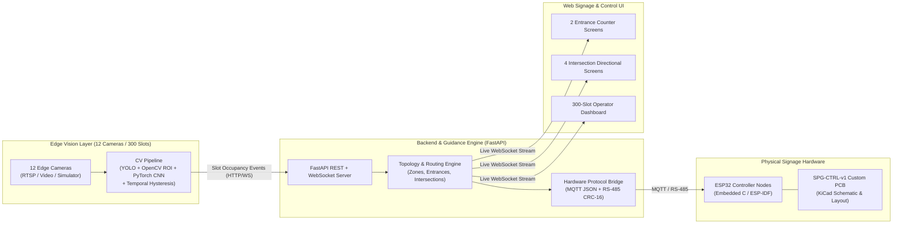

# Smart Parking Guidance & Management System

An end-to-end, automated computer-vision parking guidance and management platform designed for a **300-slot parking facility** (4 zones × 75 slots, 12 edge cameras, 2 entrance counter displays, and 4 internal intersection directional screens).

> **Stack:** Python · PyTorch · OpenCV · YOLO · FastAPI · React + Vite + Tailwind · ESP32 Embedded C (ESP-IDF) · KiCad PCB Design

---

## System Overview



---

## Key Features

- **300-Slot Multi-Camera Vision Pipeline (`cv_engine/`):**
  - YOLOv8 vehicle detection in PyTorch paired with calibrated per-slot **OpenCV ROI polygons** and a lightweight **PyTorch CNN ROI classifier**.
  - Temporal hysteresis filtering to eliminate flickering from cars driving down aisles.
  - Built-in **12-camera synthetic simulator** and interactive **ROI calibration utility**.
- **Real-Time Guidance Backend (`backend/`):**
  - **FastAPI** server computing live availability across all **4 zones**, **2 facility entrances**, and **4 internal intersections** (`← Left`, `↑ Straight`, `→ Right`).
  - Sub-second **WebSocket** streaming to web signage displays and operator dashboards.
  - **MQTT + RS-485/CRC-16** bridge for physical guidance signs and SQLite occupancy analytics.
- **Entrance, Intersection & Operator Screens (`frontend/`):**
  - High-contrast LED-style **Entrance Counter Displays** (`North` & `South` entrances).
  - Dynamic **Intersection Directional Displays** (`INT-1` – `INT-4`) with live branch counts and green/amber/red status indicators.
  - Interactive **300-Slot Operator Dashboard** with live zone map, camera health, and traffic simulation controls.
- **ESP32 Embedded C Firmware (`firmware/`):**
  - Modular **ESP-IDF C** firmware supporting Wi-Fi/MQTT and wired RS-485 binary frames with CRC-16 validation, LED/arrow drivers, watchdog timer, and offline fallback.
  - Host-compilable C unit test suite for protocol framing and display state logic.
- **Custom Controller PCB Design (`hardware/`):**
  - Complete **KiCad** project (`SPG-CTRL-v1`) featuring ESP32-WROOM-32E, isolated/ESD-protected RS-485 transceiver, 12V/24V MOSFET LED arrow drivers, buck power regulation, and BOM.

---

## Repository Structure

| Directory | Description |
| --- | --- |
| [`config/`](config/) | 300-slot facility topology, 12-camera mapping, and calibrated ROI polygons |
| [`cv_engine/`](cv_engine/) | YOLO + OpenCV ROI detection pipeline, PyTorch slot classifier, simulator, and ROI annotator |
| [`backend/`](backend/) | FastAPI REST/WebSocket server, guidance routing engine, SQLite analytics, MQTT & RS-485 bridge |
| [`frontend/`](frontend/) | React + Vite + Tailwind signage screens (Entrances & Intersections) and Operator Dashboard |
| [`firmware/`](firmware/) | ESP32 Embedded C firmware (ESP-IDF) and host-run C unit tests |
| [`hardware/`](hardware/) | KiCad schematic, PCB layout, BOM, and hardware engineering notes |
| [`tests/`](tests/) | Automated Python test suite (API, routing engine, CV pipeline, protocol framing) |
| [`docs/`](docs/) | Detailed architecture, API contracts, and RS-485/MQTT wire protocol specs |

---

## Quick Start

> Detailed setup and run instructions will be expanded as each subsystem is verified.

```bash
# 1. Generate/verify facility config
python3 config/generate_config.py

# 2. Install Python dependencies (using uv)
uv venv --python 3.12
source .venv/bin/activate
uv pip install -e ".[dev]"

# 3. Start FastAPI backend
uvicorn backend.main:app --reload --port 8000

# 4. Run 12-camera CV simulator (in another terminal)
python -m cv_engine.simulator --api-url http://localhost:8000

# 5. Start Frontend signage & dashboard
cd frontend && npm install && npm run dev
```

---

## License

MIT License — see [LICENSE](LICENSE).
